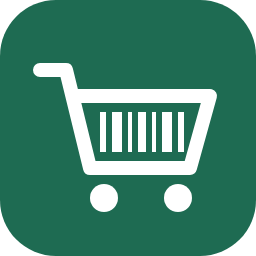

# Kroger Restock for Home Assistant



A Home Assistant custom integration that keeps your household grocery list in
Home Assistant and syncs it to your Kroger cart through Kroger's public API.

Scan a barcode with an iPhone Shortcut or a wall-mounted scanner, type an item,
or ask Assist. In-stock items go straight to your cart. Out-of-stock items stay
on the list as **waiting**. Nothing leaves the list until you check it off.

> **Not affiliated with Kroger.** This is an independent, community project.
> "Kroger" is used only to describe compatibility with Kroger's public
> developer API. It is not endorsed by, sponsored by or affiliated with The
> Kroger Co.

**Status:** Phases 1–3 are done: sign-in, store selection, barcode and text
lookup, the to-do list, cart push, the scan event, stock re-checks, order-day
holds, the give-up flag, notifications, and printing to a receipt printer or a
letter-size PDF. Examples and the ESPHome scanner come next. See [Roadmap](#roadmap).

<!-- Screenshot placeholder: the to-do list card -->
<!--  -->

## Contents

- [Requirements](#requirements)
- [1. Create a Kroger developer app](#1-create-a-kroger-developer-app)
- [2. Install through HACS](#2-install-through-hacs)
- [3. Add the integration](#3-add-the-integration)
- [How the list works](#how-the-list-works)
- [Entities](#entities)
- [Actions](#actions)
- [Events](#events)
- [Options](#options)
- [Limitations](#limitations)
- [Troubleshooting](#troubleshooting)
- [Development](#development)
- [Roadmap](#roadmap)

## Requirements

- Home Assistant **2026.11** or newer
- [HACS](https://hacs.xyz/)
- A Kroger-family store account (Kroger, Ralphs, Fred Meyer, King Soopers, …)
- A free Kroger developer account

## 1. Create a Kroger developer app

1. Go to <https://developer.kroger.com/> and sign in (or create a developer
   account; this is separate from your shopping account).
2. Open **My Apps → Register App** (the wording may differ slightly).
3. Fill in:
   - **Name:** anything, e.g. `Home Assistant Restock`
   - **Environment:** Production
   - **Redirect URI:** `https://my.home-assistant.io/redirect/oauth`
   - **Scopes / API products:** enable **Products**, **Cart** and
     **Identity**, which give these OAuth scopes:
     - `product.compact` (product search, prices, stock, aisles)
     - `cart.basic:write` (add to cart)
     - `profile.compact` (identify the account, so it can't be added twice)
4. Save, then copy the **Client ID** and **Client Secret**.

The redirect URI uses [My Home Assistant](https://my.home-assistant.io/), so
it works whether or not your Home Assistant is reachable from the internet. If
you've disabled the `my` integration, use
`https://<your-ha-url>/auth/external/callback` instead.

## 2. Install through HACS

1. In Home Assistant, open **HACS → ⋮ → Custom repositories**.
2. Add `https://github.com/thrivestorm2/ha-kroger-restock` with type
   **Integration**.
3. Find **Kroger Restock** in HACS, download it, and restart Home Assistant.

## 3. Add the integration

1. **Settings → Devices & services → Add integration → Kroger Restock.**
2. When asked for application credentials, enter the Client ID and Client
   Secret from step 1. (You can also add them first under
   **Settings → Application credentials**.)
3. Sign in to your Kroger shopping account and approve access.
4. Enter your ZIP code and pick your store. Stock levels, prices and aisles
   come from this store.
5. Choose **Pickup** (default) or **Delivery**.

You get a to-do list called **Grocery list** (entity ID based on your store
name, e.g. `todo.kroger_downtown`), plus sensors and a **Sync now** button.

## How the list works

Home Assistant's list is the source of truth. Every item has a status:

| Status | Meaning | Pushed to cart? |
| --- | --- | --- |
| `in_cart` | Found and in stock; pushed to your Kroger cart | Yes |
| `waiting` | Found but temporarily out of stock | No |
| `held` | Back in stock, waiting for the order-day window | Not yet |
| `needs_review` | A text or produce match needs you to pick the product | No |
| `unmatched` | The barcode isn't in Kroger's catalog | No |
| `received` | You checked it off | — |

- **Scanning** looks the product up at your store. In stock → cart.
  Out of stock → `waiting`. Unknown barcode → `unmatched`, with the raw code as
  the name so you can fix it. Nothing is ever dropped.
- **Scanning something already on the list** adds 1 to its quantity, and only
  the extra unit is pushed. Repeat scans of the same code within the debounce
  window (3 s by default) are ignored, so a wall scanner can't double-count.
- **Typing or saying an item** searches your store. One clear match is handled
  like a scan. Otherwise the item is marked `needs_review` with up to five
  candidates; fix it with `kroger_restock.resolve_item`.
- **Produce stickers (PLU codes)** like `4011` are searched by name and always
  marked `needs_review`.
- **Waiting items are re-checked** every few hours (3 h by default), with the
  calls spread out. When one comes back in stock it's pushed right away, or,
  if you've set order days, marked `held` and pushed in the window before your
  order day. You get a notification either way.
- **Give-up flag:** an item waiting longer than the give-up setting (30 days by
  default) raises a Repairs issue where you choose **Keep waiting** (restarts
  the clock) or **Remove from list**. Items are never removed automatically.
- **Checking an item off** marks it `received`. That's the only way it leaves
  the active list.
- **Unchecking a received item**, or calling `kroger_restock.readd_item`
  ("they shorted me at pickup"), checks stock again and pushes it again.
- **No double pushes.** The integration records how many units of each item it
  has pushed. Syncing only sends what hasn't been sent yet.
- In the to-do list, each item reads `Name (size) ×qty`. The description shows
  its status, e.g. `In cart · Aisle 12` or `Waiting on stock since Nov 21`.
  Editing the `×qty` part changes the quantity (and pushes the difference).

### How barcodes are matched

Kroger product IDs are 13 digits. For each scan the integration tries, in
order, and stops at the first hit:

1. UPC-A (12 digits): drop the check digit, left-pad to 13
2. EAN-13: drop the check digit, left-pad to 13
3. UPC-E (8 digits): expand to UPC-A, then rule 1
4. Fallback: the full code, left-pad to 13

Successful matches are remembered, and so is any fix you make with
`resolve_item`, so the next scan of that code goes straight through.

## Entities

| Entity | Description |
| --- | --- |
| `todo.<store>` | The grocery list (create, edit, check off, delete, reorder) |
| `sensor.<store>_in_cart` | Number of items pushed to the cart |
| `sensor.<store>_waiting_on_stock` | Number of out-of-stock items |
| `sensor.<store>_held_for_order_day` | Number of held items |
| `sensor.<store>_needs_review` | Number of items to review |
| `sensor.<store>_unmatched` | Number of unknown barcodes |
| `sensor.<store>_last_stock_check` | When stock was last checked |
| `button.<store>_sync_now` | Push any pending cart items |
| `button.<store>_check_stock_now` | Re-check waiting items now |
| `button.<store>_print_receipt` | Print to the receipt printer |
| `button.<store>_print_pdf` | Make (and print) the letter-size PDF |

## Actions

Every action returns response data (optional), so an iOS Shortcut or script
can show the result. If you have more than one Kroger Restock entry, pass
`config_entry_id`.

### `kroger_restock.scan_upc`

| Field | Required | Default | Description |
| --- | --- | --- | --- |
| `upc` | yes | | UPC-A, UPC-E, EAN-13 or PLU code |
| `quantity` | no | 1 | How many |
| `source` | no | `scan` | `scan`, `shortcut`, `esphome`, `manual` or `assist` |

```yaml
action: kroger_restock.scan_upc
data:
  upc: "049000028911"
  source: shortcut
response_variable: result
```

Example response:

```yaml
result: in_cart        # in_cart, waiting, unmatched, needs_review, duplicate
item_id: 3f2a...
status: in_cart
name: Coca-Cola Classic Soda
brand: Coca-Cola
size: 12 fl oz
price: 7.99
aisle: Aisle 7
quantity: 1
upc: "0004900002891"
product_id: "0004900002891"
stock_level: HIGH
image_url: https://...
pushed: true           # false if the cart push failed (it is retried on sync)
```

A scan ignored by the debounce returns `{result: duplicate, debounced: true}`.

### `kroger_restock.add_item`

Adds an item by name (`name`, `quantity`, `source`). Same response shape. If
the item needs review, the response includes `candidates`.

### `kroger_restock.resolve_item`

Fixes an `unmatched` or `needs_review` item: `item_id`, plus `product_id`
(the 13-digit Kroger product ID, or a UPC). The barcode is remembered.

### `kroger_restock.sync`

Pushes any `in_cart` items whose push is still pending (for example after a
network error). Returns `pushed`, `pending` and the items pushed. Units that
were already pushed are never sent again.

### `kroger_restock.readd_item`

Puts an item back (`item_id`) and pushes it again after a stock check. Use it
when an order was shorted. It's the only way an already-pushed item is pushed
again, and it pushes the full quantity.

### `kroger_restock.check_stock`

Re-checks every waiting item now and pushes held items if you're inside the
order window. Returns `checked`, `back_in_stock`, `pushed`, `held`,
`still_waiting` and `held_pushed`.

### `kroger_restock.print_list`

Prints the list. `target`: `receipt`, `pdf` or `both` (default). Returns
`items`, `receipt` (`printed`, `failed` or `not_configured`) and `pdf`
(`path` of the saved file and whether it was `printed`). See
[Printing](#printing).

## Events

### `kroger_restock_scanned`

Fired after every scan or text add (not for debounced repeats).

| Key | Example |
| --- | --- |
| `result` | `in_cart`, `waiting`, `unmatched`, `needs_review` or `duplicate` |
| `name`, `brand`, `size` | `Coca-Cola Classic Soda`, `Coca-Cola`, `12 fl oz` |
| `price` | `7.99` |
| `aisle` | `Aisle 7` |
| `quantity` | `1` |
| `upc` | `0004900002891` |
| `source` | `esphome` |
| `item_id`, `config_entry_id` | |

```yaml
triggers:
  - trigger: event
    event_type: kroger_restock_scanned
    event_data:
      result: waiting
actions:
  - action: notify.mobile_app_phone
    data:
      message: "{{ trigger.event.data.name }} is out of stock; it's on the list."
```

### `kroger_restock_back_in_stock`

Fired when a stock check finds waiting items back in stock. Data: `pushed` and
`held` (lists of `{item_id, name}`) and `config_entry_id`.

## Printing

Both printouts use the same layout:

- A header with the date and your store
- Items in your cart (and held items) grouped by aisle, in aisle order, with a
  checkbox, name, size and quantity. Items with no aisle come last under
  **Other**.
- **Waiting — check shelf:** out-of-stock items, in case they're on the shelf
  anyway
- **Needs review:** unmatched and needs-review items
- A footer with the item count

**Receipt printer (ESC/POS).** Any network thermal printer that accepts raw
jobs on port 9100 works; no driver is needed. The integration sends plain
ESC/POS: initialize, bold headers, word-wrapped lines and a paper cut. Choose
58 mm (32 columns) or 80 mm (48 columns) paper.

**Letter-size PDF.** Every PDF is saved to `/media/kroger_restock/` (turn this
off in options), so you can open it from **Media → My media**. If you enter an
IPP printer URL (for example `ipp://printer.local/ipp/print`, or `ipps://…`),
the PDF is also sent as an IPP Print-Job. Most network printers made in the
last decade support IPP and PDF; if yours doesn't accept PDF, use the saved
file instead.

<!-- Screenshot placeholder: receipt and PDF printouts -->

## Options

**Settings → Devices & services → Kroger Restock → Configure**:

- **Change store** (by ZIP code)
- **Order type:** Pickup or Delivery
- **Scan debounce** (default 3 s)
- **Order days** and **lead time** (default: none, 1 day). With order days
  set, back-in-stock items are held and pushed from `lead time` days before an
  order day through the order day. Example: order day Saturday, lead time 1 →
  pushed on Friday or Saturday.
- **Stock check interval** (default 3 h)
- **Give-up after** (default 30 days)
- **Notification targets:** `notify.mobile_app_*` actions. With none chosen,
  you get a persistent notification in Home Assistant instead.

**Printing** (its own page in the options menu):

- **Receipt printer host** and **port** (default 9100)
- **Paper width:** 58 mm or 80 mm (default 80 mm)
- **PDF printer (IPP URL):** optional
- **Save PDFs to /media/kroger_restock** (default on)

## Limitations

These come from Kroger's public API:

- **The cart is write-only.** The API can add to your cart but can't read it
  or remove from it. The integration keeps its own record of what it pushed.
  **If you remove or change items in the Kroger app or website, Home Assistant
  won't know.** Deleting an item from the Home Assistant list doesn't remove it
  from your Kroger cart either.
- **No Kroger Shopping List, order history or checkout.** You still place the
  order in the Kroger app or website.
- **Daily rate limits** apply per endpoint (about 10,000 product calls, 5,000
  cart calls and 1,600 location calls per day). The integration caches product
  lookups and barcode matches, checks duplicates before calling the API, and
  batches cart pushes. Call counts appear in diagnostics.
- **Stock levels are Kroger's estimate.** Items with no stock data are treated
  as available.
- Items typed in the to-do UI or spoken through Assist are recorded with
  source `manual`; use `add_item` with `source: assist` to tag them yourself.

## Troubleshooting

- **"Kroger sign-in expired" repair:** Kroger rejected the saved refresh token.
  Open the integration and re-authenticate. Scans that fail during this time
  return an error; items already on the list are kept.
- **Diagnostics:** **⋮ → Download diagnostics** on the integration. Tokens,
  your store address and account ID are redacted.
- **Debug logs:**

  ```yaml
  logger:
    logs:
      custom_components.kroger_restock: debug
  ```

## Development

```bash
python3.14 -m venv .venv && . .venv/bin/activate
pip install -r requirements_test.txt
ruff format . && ruff check .
pytest
UPDATE_GOLDEN=1 pytest tests/test_printing.py   # after changing a print layout
python script/gen_translations.py   # after editing strings.json
node script/render_icons.js         # after editing assets/*.svg
```

`tests/test_live_cart.py` is an optional, manual check against the real API
(it shows whether Kroger's cart accepts an out-of-stock UPC). It is skipped
unless `KROGER_LIVE_*` environment variables are set, and it adds one unit to
the real cart.

## Roadmap

1. ✅ **Core:** OAuth, store selection, API client, barcode normalization,
   storage, to-do list, `scan_upc` / `add_item` / `resolve_item` / `sync`,
   cart push, scan event, tests, CI
2. ✅ Stock re-checks, `held` and order-day window, give-up flag,
   notifications, `readd_item`, check-stock button
3. ✅ Printing: ESC/POS receipt printer and letter-size PDF over IPP
4. Blueprint, example automations, iOS Shortcut guide
5. ESPHome wall scanner

## License

[MIT](LICENSE)
